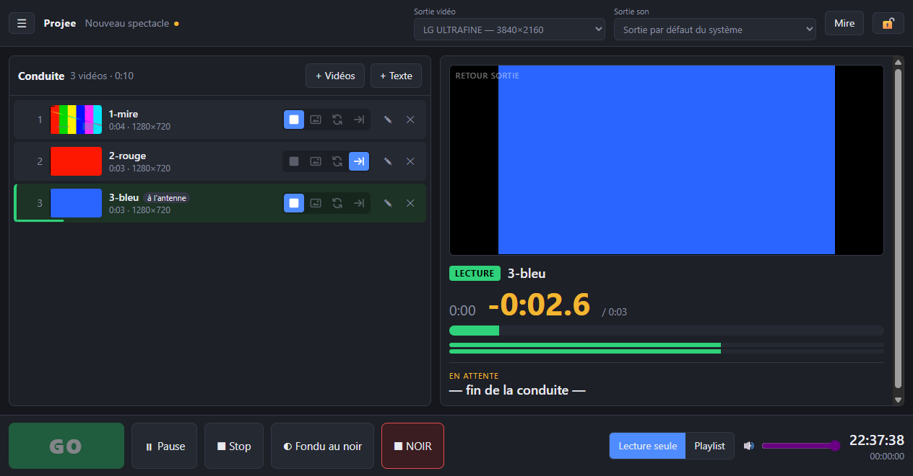
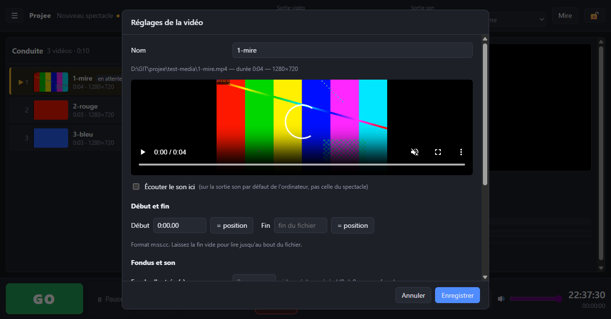

# Projee

Lecteur vidéo pour le **spectacle**, sur PC (Windows) et Mac. Libre et gratuit.

Vous gardez la régie sur l'écran de l'ordinateur ; les vidéos passent en plein écran sur le projecteur.
**Le projecteur ne montre que du noir** tant qu'aucune vidéo n'est lancée : pas de bouton, pas de curseur,
pas de première image figée. Chaque vidéo part du noir et revient au noir.

De la même famille que [Jinglee](https://github.com/mathgen44/jinglee), le lecteur de jingles.



## Télécharger

**👉 [Dernière version de Projee](https://github.com/mathgen44/projee/releases/latest)**

| Ordinateur | Fichier à prendre |
|---|---|
| Windows 10 ou 11 | `Projee-…-Windows-installation.exe` |
| Windows, sans rien installer (clé USB, ordinateur prêté) | `Projee-…-Windows-portable.exe` |
| Mac (Intel ou Apple Silicon), macOS 12 ou plus récent | `Projee-…-Mac.dmg` |

### Installer sur Windows

1. Lancez `Projee-…-Windows-installation.exe`.
2. Si Windows affiche « Windows a protégé votre ordinateur », cliquez sur **Informations complémentaires**,
   puis **Exécuter quand même**. Ce message apparaît pour les logiciels gratuits qui ne paient pas de certificat Microsoft.
3. Suivez l'installation ; Projee apparaît dans le menu Démarrer.

La version **portable** se lance directement, sans installation.

### Installer sur Mac

1. Ouvrez `Projee-…-Mac.dmg` et **glissez Projee dans le dossier Applications**.
2. Lancez Projee depuis Applications. Au premier lancement, macOS refuse de l'ouvrir, car Projee n'est pas
   enregistré auprès d'Apple (c'est payant). Il suffit de l'autoriser une fois :
   - **macOS 15 (Sequoia) et plus récent** : fermez le message, ouvrez **Réglages Système → Confidentialité et sécurité**,
     descendez jusqu'à « Projee a été bloqué » et cliquez sur **Ouvrir quand même**, puis confirmez avec votre mot de passe.
   - **macOS 14 et plus ancien** : dans Applications, faites **Ctrl + clic** (ou clic droit) sur Projee → **Ouvrir**,
     puis **Ouvrir** dans le message.
3. Les lancements suivants se font normalement.

Si macOS indique que Projee « est endommagé et ne peut pas être ouvert », ouvrez l'application **Terminal**,
collez la ligne suivante, appuyez sur Entrée, puis relancez Projee :

```bash
xattr -cr /Applications/Projee.app
```

## Premiers pas

1. **Branchez le projecteur** et réglez l'affichage en mode **Étendre** (et non Dupliquer) :
   - Windows : touche **Windows + P** → *Étendre* ;
   - Mac : *Réglages Système → Moniteurs*, et désactivez la recopie vidéo.
2. Lancez Projee. En haut, choisissez la **Sortie vidéo** (le projecteur) et la **Sortie son**
   (carte son, HDMI du projecteur…). Projee s'en souvient pour la fois suivante.
3. Cliquez sur **Mire** : une grille s'affiche sur le projecteur pour vérifier que c'est le bon écran et que le cadrage est bon.
   Cliquez à nouveau pour revenir au noir.
4. **Ajoutez vos vidéos** : glissez-les dans la conduite, ou cliquez sur **+ Vidéos**. Réorganisez-les en les faisant glisser.
   Chaque vidéo est testée dès son ajout : si l'ordinateur ne sait pas la lire, elle est signalée en rouge.
5. Choisissez pour chaque vidéo **ce qui se passe à la fin**, grâce aux quatre icônes sur sa ligne :

   | Icône | À la fin de la vidéo |
   |---|---|
   | ■ | Retour au noir (par défaut) |
   | 🖼 | L'image reste figée jusqu'au GO suivant |
   | 🔁 | La vidéo boucle (fond d'attente) jusqu'au GO suivant ou au Stop |
   | →\| | La vidéo suivante s'enchaîne aussitôt, sans passer par le noir |

6. **Enregistrez** le projet (menu ☰ → *Enregistrer*, ou Ctrl+S). Il se rouvre tout seul au prochain lancement.

## Pendant le spectacle

- La vidéo **en attente** est surlignée en jaune, avec ses notes de régie à droite. Elle est déjà préparée pour partir instantanément.
- **GO** (ou la barre Espace) la lance. La vidéo suivante passe alors en attente.
  Cliquez sur une autre vidéo pour la mettre en attente ; double-cliquez pour la lancer tout de suite.
- À droite, le **retour** montre ce qui passe sur le projecteur, avec le **temps restant en grand** et le niveau du son.
  Cliquez dans la barre de progression pour vous déplacer dans la vidéo.
- Les boutons de sécurité :

  | Bouton | Effet |
  |---|---|
  | **Pause** | Met en pause (l'image reste figée sur le projecteur) ; un second appui reprend |
  | **Stop** | Arrête la vidéo avec un fondu très court |
  | **Fondu au noir** | Fait disparaître l'image et le son en douceur (2 s par défaut) |
  | **NOIR** | Coupe immédiatement l'image et le son |

- Le **cadenas** verrouille le mode spectacle : plus aucune modification possible par erreur. Le GO et les boutons de sécurité restent actifs.
- En bas à droite : l'horloge et un chronomètre (clic pour démarrer ou arrêter, double-clic pour remettre à zéro).

### Lecture seule ou playlist

- **Lecture seule** : un GO par vidéo. Entre deux vidéos, le projecteur reste noir jusqu'au GO suivant.
- **Playlist** : un seul GO lance toute la liste, qui s'enchaîne jusqu'au bout (avec un temps de noir réglable entre deux vidéos).

## Régler une vidéo

Cliquez sur ✎ à droite d'une vidéo :



- **Nom** affiché dans la conduite.
- **Début et fin** : pour ne lire qu'une partie du fichier. Placez la lecture au bon endroit dans l'aperçu,
  puis cliquez sur **= position**.
- **Fondus** d'entrée (depuis le noir) et de sortie (vers le noir). Par défaut, coupe franche.
- **Volume** de cette vidéo (jusqu'à 200 %).
- **Cadrage** : adapter avec des bandes noires (par défaut), remplir l'écran en rognant les bords, ou étirer l'image.
- **Notes de régie** : affichées quand la vidéo est en attente (repère, réplique de départ…).

Les valeurs par défaut (fondus, durée du Fondu au noir, comportement de la pause…) se règlent dans *menu ☰ → Réglages*.

## Raccourcis clavier

| Touche | Action |
|---|---|
| `Espace` ou `Page suivante` | GO |
| `P` | Pause / reprise |
| `S` | Stop |
| `Échap` | Fondu au noir |
| `Maj + Échap` ou `B` | NOIR immédiat |
| `↑` `↓` ou `Page précédente` | Choisir la vidéo en attente |
| `Ctrl + S` / `Ctrl + O` (`⌘` sur Mac) | Enregistrer / ouvrir un projet |

Une **pédale** ou une **télécommande de présentation** qui envoie Espace ou Page suivante déclenche le GO.

## Formats vidéo

- Le plus sûr : **MP4 en H.264**, lisible partout.
- Possibles : MP4 en HEVC (H.265, selon l'ordinateur), WebM.
- Non lus : ProRes, DNxHD, la plupart des AVI. Convertissez-les avant, par exemple avec le logiciel gratuit
  [HandBrake](https://handbrake.fr/) (préréglage « Fast 1080p30 »).

## Emporter un spectacle sur un autre ordinateur

*Menu ☰ → Exporter avec les vidéos* copie le projet **et toutes ses vidéos** dans un dossier.
Copiez ce dossier sur une clé USB, puis sur l'autre ordinateur ouvrez le fichier `.projee` qu'il contient.
Cela marche aussi d'un PC vers un Mac, et inversement.

Si des vidéos ont été déplacées, elles apparaissent en rouge : cliquez sur **Relier…** et indiquez où elles se trouvent.
Les autres vidéos du même dossier sont retrouvées en même temps.

## Conseils pour le spectacle

- Activez **Ne pas déranger** sur l'ordinateur pour qu'aucune notification n'apparaisse.
- Branchez l'ordinateur portable sur secteur. Projee empêche la mise en veille de l'écran pendant qu'il est ouvert.
- Avant le public : **Mire**, test d'une vidéo avec le son, puis **cadenas**.
- Préparez la conduite sur l'ordinateur du spectacle lui-même : les formats lisibles dépendent de la machine.
- Sur Mac, vérifiez dans *Réglages Système → Bureau et Dock* que l'option
  « Les écrans disposent d'espaces distincts » est activée.

## Mises à jour

Au lancement, Projee vérifie s'il existe une nouvelle version et l'annonce dans un bandeau bleu.
Rien ne s'installe tout seul : cliquez sur **Télécharger**, puis, en dehors d'un spectacle :

- **Windows** : quittez Projee et lancez le fichier téléchargé ; il remplace l'ancienne version.
- **Mac** : ouvrez le fichier téléchargé et glissez Projee dans Applications en remplaçant l'ancienne version.

Vos projets et réglages sont conservés. La vérification peut être désactivée dans *menu ☰ → Réglages*,
et lancée à la main par *menu ☰ → Rechercher une mise à jour*.

## En cas de problème

| Problème | Solution |
|---|---|
| Le projecteur n'apparaît pas dans « Sortie vidéo » | Vérifiez le câble et le mode **Étendre** (Windows + P). La liste se met à jour toute seule au branchement. |
| La vidéo s'affiche sur le mauvais écran | Changez la « Sortie vidéo », puis vérifiez avec **Mire**. |
| Pas de son | Vérifiez la « Sortie son » et le volume (curseur en bas à droite, et volume de la vidéo dans ✎). |
| Une vidéo est en rouge « Format non pris en charge » | Convertissez-la en MP4 H.264 (voir *Formats vidéo*). |
| Une vidéo est en rouge « Fichier introuvable » | Cliquez sur **Relier…** et retrouvez le fichier. |
| Le projecteur a été débranché pendant le spectacle | Rebranchez-le : la sortie revient d'elle-même. Le son continue entre-temps. |

Pour signaler un problème ou proposer une idée : [ouvrir un ticket](https://github.com/mathgen44/projee/issues).
Le dossier du journal d'erreurs est indiqué dans *menu ☰ → Réglages*.

---

Vous voulez modifier Projee ou construire l'application vous-même ? Voir [docs/DEVELOPPEMENT.md](docs/DEVELOPPEMENT.md).

Licence MIT.
